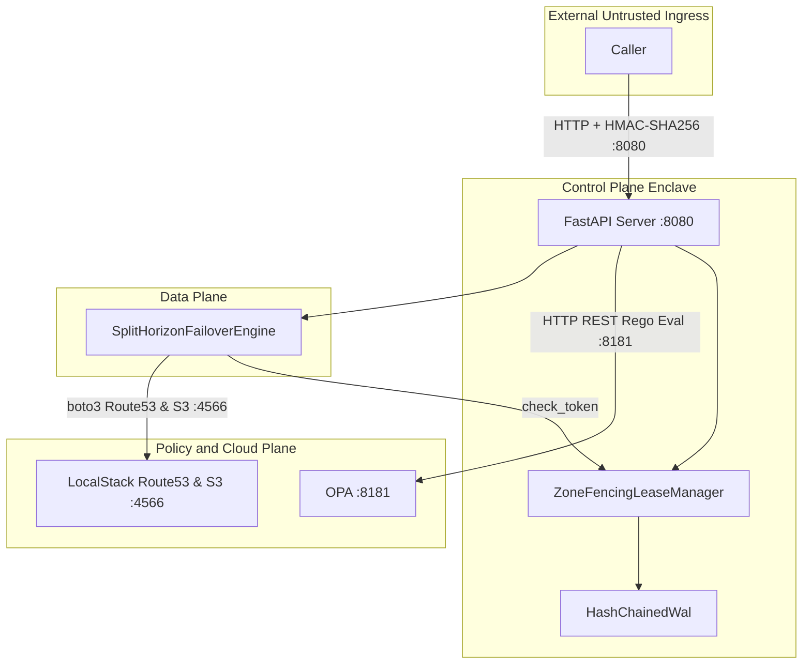
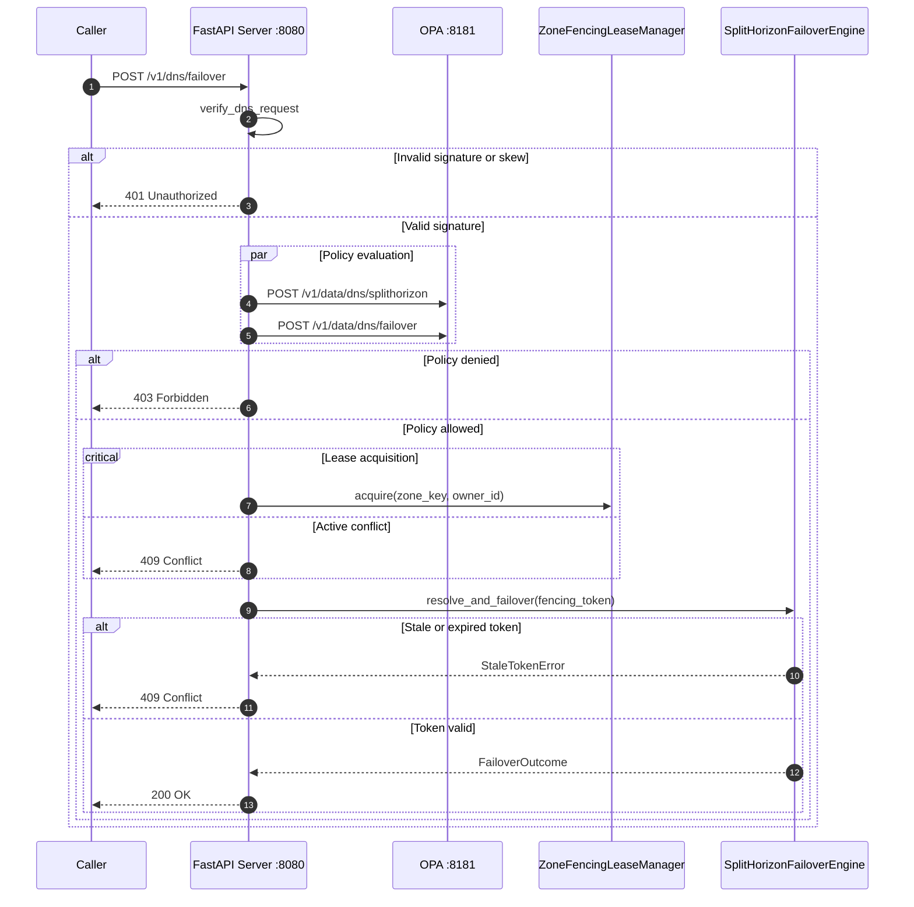
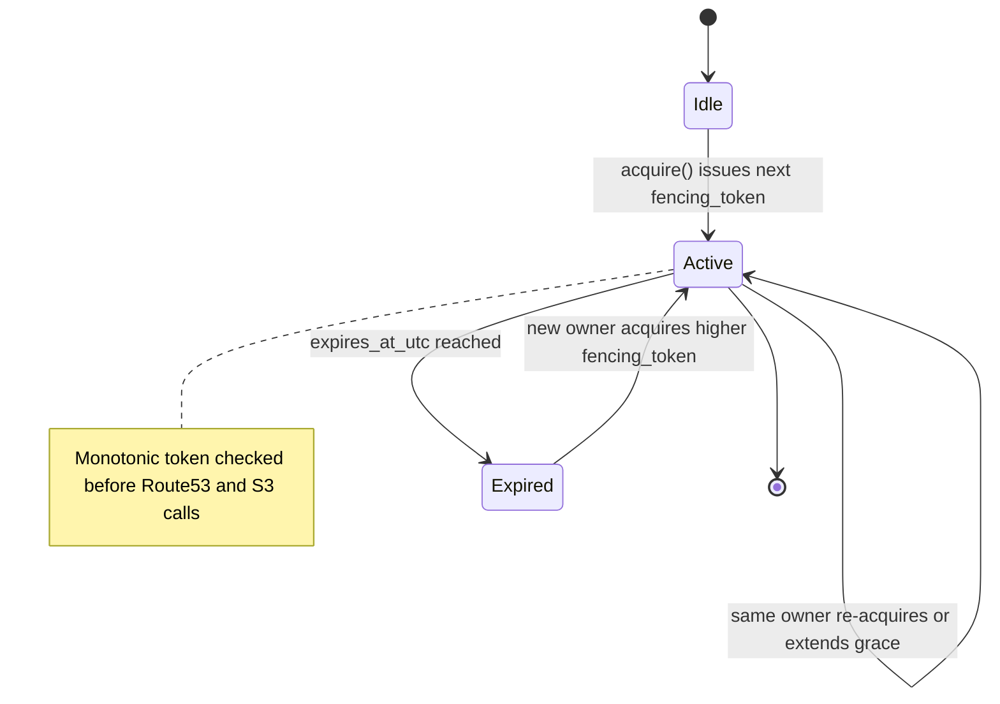
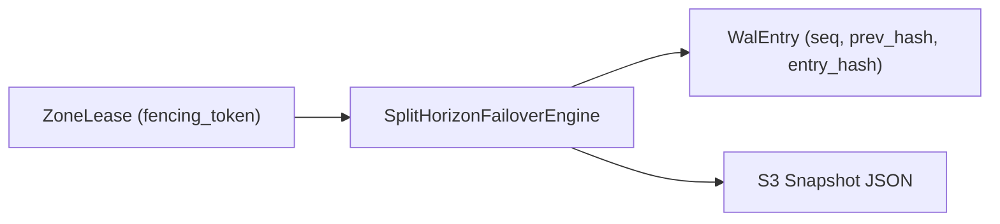

# Design Notes: Global DNS Architecture with Split-Horizon and Failover

This system separates zone lease management and hash-chained WAL recording (`controlplane/zone_lease.py`, `controlplane/server.py`, `storage/wal_chain.py`) from DNS failover execution (`dataplane/dns_failover.py`) over AWS Route53 and S3 with Open Policy Agent (OPA) checks.

## Trust-Boundary and Network Enclave Topology

## Distributed Concurrency and Failover Sequence

## Zone Lease Lifecycle

## WAL and Failover Record Lineage

## Trade-Offs and Limitations

Lease expirations and UTC change windows use UTC timestamps so Daylight Saving Time changes do not shift cutoffs. Off-window failovers allow up to a 15-minute grace lock when an incident ID of at least 4 characters is provided. Transient Route53 and S3 errors retry up to 4 times with per-attempt delay capped at `2.0s`.

Limitations: `ZoneFencingLeaseManager` and `HashChainedWal` reside in single-process memory rather than a distributed store, and `list_hosted_zones` reads a single page without pagination loops.
