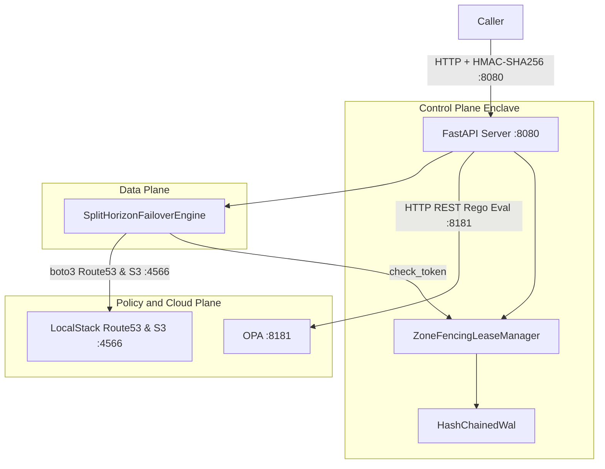

# global-dns-split-horizon-controlplane

Python FastAPI control plane and failover engine for split-horizon DNS (`internal` and `external` views) with monotonic zone fencing tokens, SHA-256 hash-chained WAL entries, OPA policy checks, and AWS Route53/S3 calls.



## Prerequisites

- Python 3.10+
- Docker and Docker Compose
- `curl` and `openssl`

## Local Setup

Start LocalStack (`route53,s3`) and OPA:

```bash
make up
```

Run the control plane:

```bash
make run
```

Run tests, chaos test, and benchmark:

```bash
make test
make chaos
make bench
```

Stop containers:

```bash
make down
```

## Sample Request

```bash
BODY='{"fqdn":"edge.api.example.internal","horizon":"external","record_type":"A","owner_id":"reconciler-1","actor_role":"dns-reconciler","primary_ip":"198.51.100.10","fallback_ip":"203.0.113.20","primary_healthy":false}'
TS=$(date -u +%s)
SIG="sha256=$(printf '%s.%s' "$TS" "$BODY" | openssl dgst -sha256 -hmac 'local-dev-dns-secret' | awk '{print $2}')"

curl -s -X POST http://localhost:8080/v1/dns/failover   -H "Content-Type: application/json"   -H "X-Timestamp: $TS"   -H "X-Signature-256: $SIG"   -d "$BODY"
```

## Measured Output

From running `python3 -m unittest discover -s tests -p "test_*.py" -v`:

- `Ran 5 tests in 0.070s` (`OK`).
- `BENCH lease+check+wal (2000 ops): 54.77 ms (27.39 us/op)`.

## Known Limitations

- In-memory `ZoneFencingLeaseManager` and `HashChainedWal` are per-process rather than backed by a shared database or consensus store.
- Single AWS region per process (`AWS_REGION`).
- `list_hosted_zones` reads the first response page without pagination loops.
